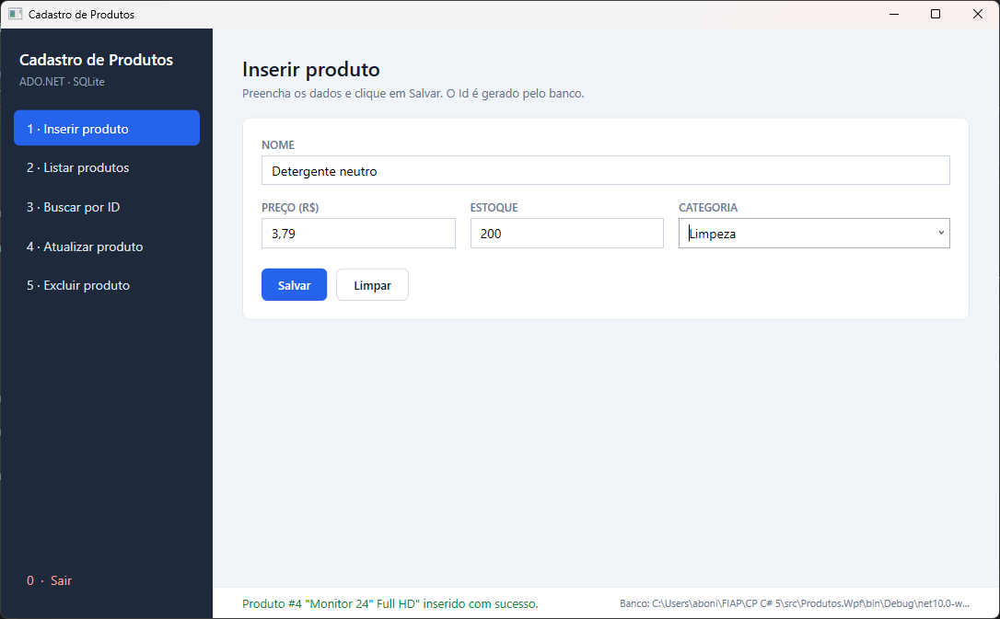
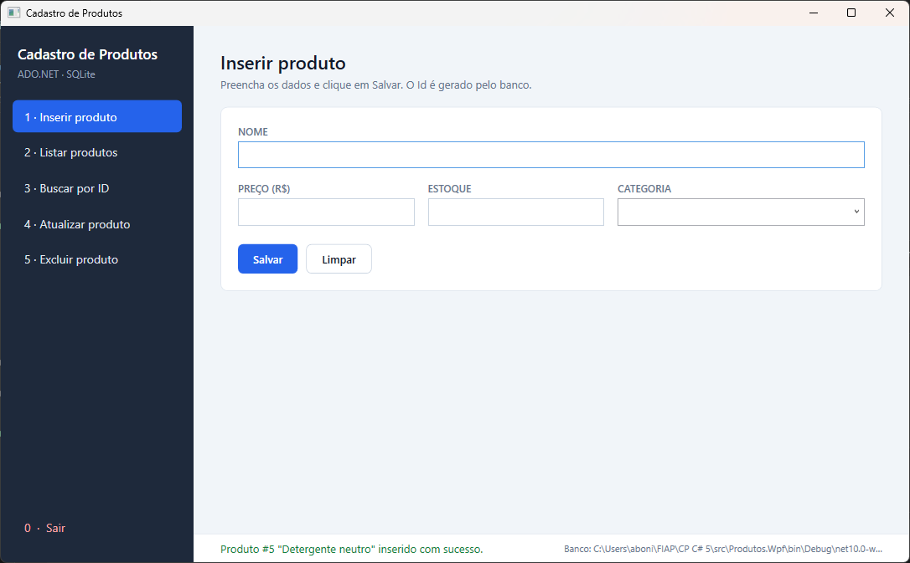
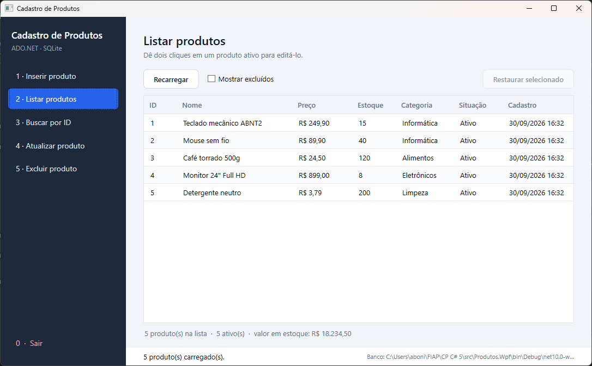
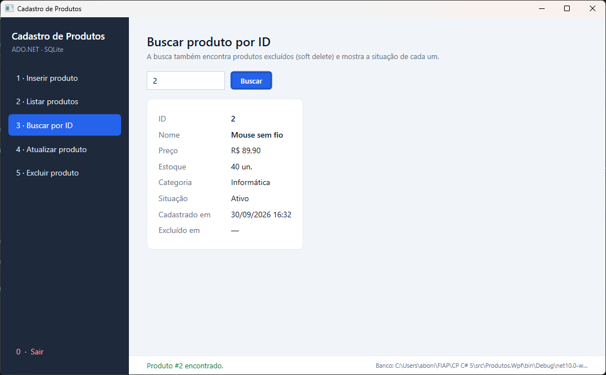
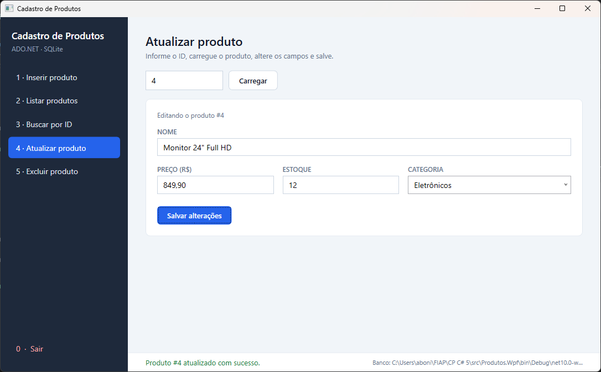
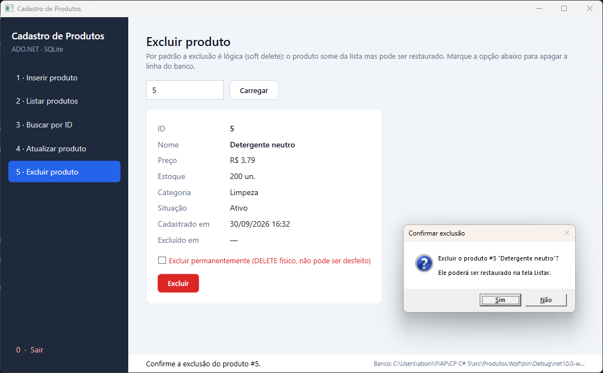
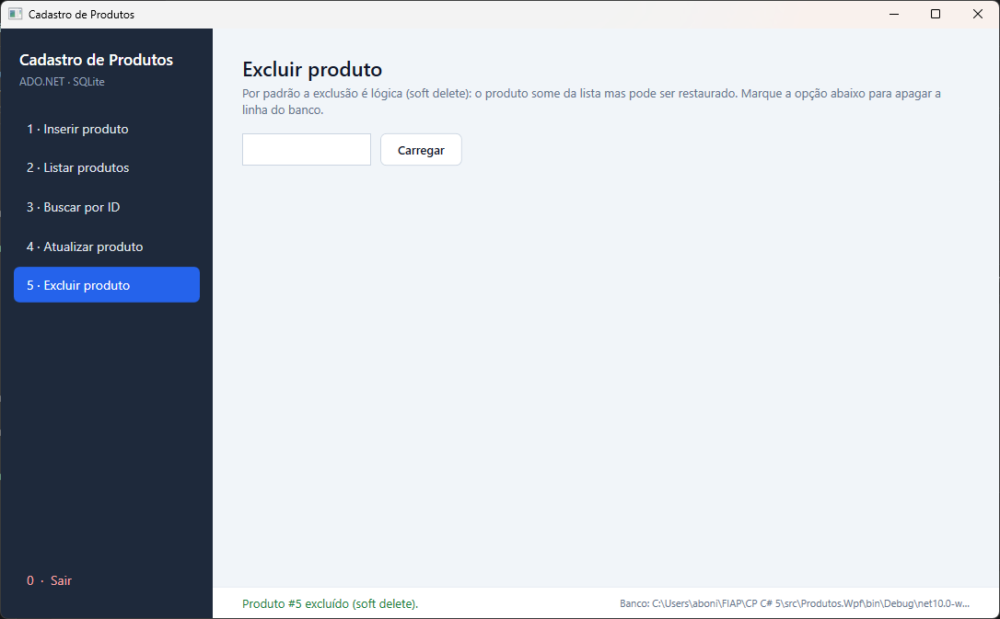
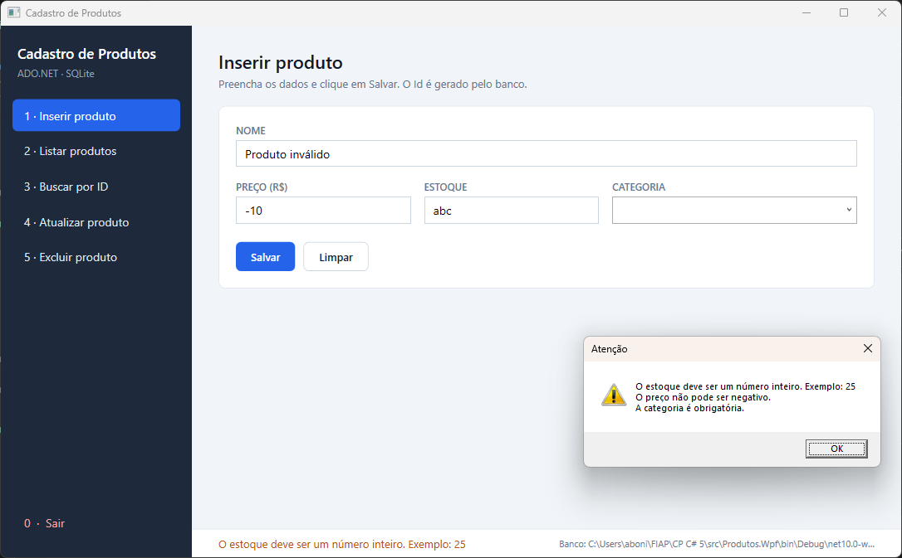
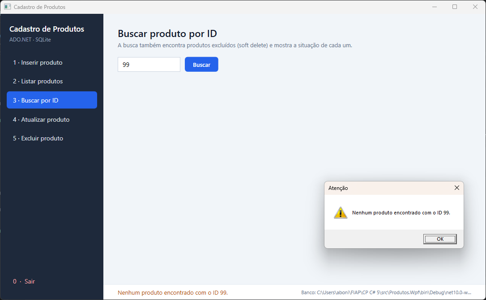
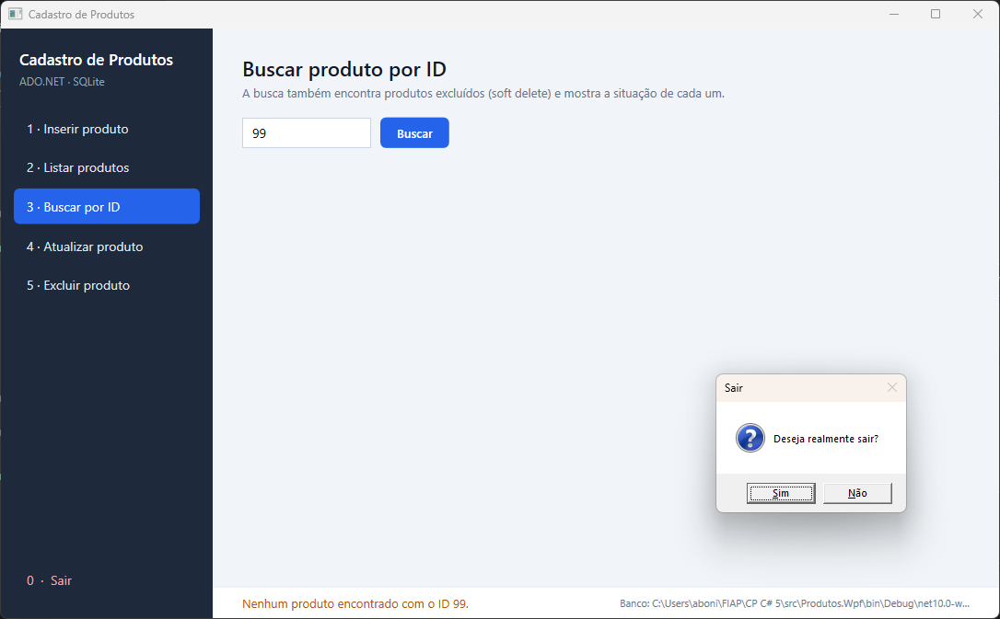

# Cadastro de Produtos: WPF + ADO.NET

Aplicação desktop em **C# / WPF** para cadastrar e gerenciar produtos, com acesso ao banco feito
diretamente com **ADO.NET** (`Microsoft.Data.Sqlite`), sem ORM.

**Integrantes**

| Nome | RM |
|---|---|
| Arthur Abonizio Vaini Ferreira | 555506 |
| Gabriel Padula | 554907 |

**Vídeo da apresentação:** _cole aqui o link_

---

## O que a aplicação faz

| Menu | Operação | Método do repositório | Comando ADO.NET |
|---|---|---|---|
| 1 · Inserir produto | `INSERT` | `Inserir` | `ExecuteNonQuery` (+ `ExecuteReader` para ler o Id gerado) |
| 2 · Listar produtos | `SELECT` | `Listar` | `ExecuteReader` |
| 3 · Buscar por ID | `SELECT ... WHERE Id = @Id` | `BuscarPorId` | `ExecuteReader` |
| 4 · Atualizar produto | `UPDATE` | `Atualizar` | `ExecuteNonQuery` |
| 5 · Excluir produto | `UPDATE Ativo = 0` (soft delete) ou `DELETE` | `Excluir` / `ExcluirPermanentemente` | `ExecuteNonQuery` |
| 0 · Sair | fecha a aplicação | — | — |

Extras: restaurar produto excluído, validação dos campos, log de todas as operações em arquivo e 23 testes automatizados.

## Tecnologias

- .NET 10 · C# · WPF
- SQLite através do provider ADO.NET `Microsoft.Data.Sqlite`
- `Microsoft.Extensions.Configuration.Json` para ler o `appsettings.json`
- MSTest para os testes unitários

## Estrutura

```
CadastroProdutos.sln
├── database/
│   └── criar_tabela_produtos.sql      ← script de criação da tabela (entregável)
├── src/
│   ├── Produtos.Core/                 ← regras e acesso a dados (sem nenhuma dependência de tela)
│   │   ├── Models/Produto.cs          ← classe Produto + validação
│   │   ├── Data/IProdutoRepository.cs
│   │   ├── Data/ProdutoRepository.cs  ← TODO o SQL da aplicação
│   │   ├── Data/DatabaseInitializer.cs← executa o script .sql na inicialização
│   │   ├── Data/RepositorioException.cs
│   │   └── Logging/ArquivoOperacaoLogger.cs
│   └── Produtos.Wpf/                  ← interface (menu, formulários, tabela)
│       ├── appsettings.json           ← connection string
│       ├── App.xaml(.cs)              ← monta config, log, banco e repositório
│       ├── MainWindow.xaml(.cs)       ← menu com as 6 opções
│       └── Views/ProdutoFormulario.xaml(.cs)
├── tests/
│   └── Produtos.Tests/                ← testes do repositório (CRUD, SQL injection, erros, log)
└── docs/prints/                       ← prints das operações
```

A interface (`Produtos.Wpf`) só conhece a interface `IProdutoRepository`. Nenhum comando SQL aparece na
camada de tela. O projeto `Produtos.Core` não referencia WPF, por isso os testes usam o repositório
diretamente.

---

## Como configurar e executar

### 1. Pré-requisitos

- Windows 10 ou 11
- [.NET SDK 10](https://dotnet.microsoft.com/download/dotnet/10.0): `winget install Microsoft.DotNet.SDK.10`
- Não é preciso instalar servidor de banco: o SQLite é embutido e o arquivo do banco é criado sozinho.

### 2. Executar

```bash
git clone <url-do-repositorio>
cd <pasta-do-repositorio>
dotnet run --project src/Produtos.Wpf
```

Pelo Visual Studio 2026: abra `CadastroProdutos.sln`, defina **Produtos.Wpf** como projeto de
inicialização e pressione F5.

Ao abrir, a aplicação:

1. lê o `appsettings.json`;
2. executa `database/criar_tabela_produtos.sql` (cria a tabela se ainda não existir);
3. abre a janela com o menu.

### 3. Rodar os testes

```bash
dotnet test
```

### Connection string

Fica em [src/Produtos.Wpf/appsettings.json](src/Produtos.Wpf/appsettings.json):

```json
{
  "ConnectionStrings": {
    "ProdutosDb": "Data Source=produtos.db"
  },
  "Banco": { "ScriptCriacao": "database/criar_tabela_produtos.sql" },
  "Log":   { "Arquivo": "logs/operacoes.log" }
}
```

Caminhos relativos são resolvidos a partir da pasta do executável
(`src/Produtos.Wpf/bin/Debug/net10.0-windows/`). O rodapé da janela mostra o caminho completo do
banco e do log em uso. Para usar outro arquivo, troque o `Data Source`
(ex.: `Data Source=C:\dados\loja.db`).

---

## Banco de dados

Script completo em [database/criar_tabela_produtos.sql](database/criar_tabela_produtos.sql):

```sql
CREATE TABLE IF NOT EXISTS Produtos (
    Id            INTEGER PRIMARY KEY AUTOINCREMENT,
    Nome          TEXT    NOT NULL CHECK (length(trim(Nome)) BETWEEN 1 AND 100),
    Preco         REAL    NOT NULL CHECK (Preco >= 0),
    Estoque       INTEGER NOT NULL DEFAULT 0 CHECK (Estoque >= 0),
    Categoria     TEXT    NOT NULL CHECK (length(trim(Categoria)) BETWEEN 1 AND 50),
    Ativo         INTEGER NOT NULL DEFAULT 1 CHECK (Ativo IN (0, 1)),
    DataCadastro  TEXT    NOT NULL DEFAULT (datetime('now', 'localtime')),
    DataExclusao  TEXT    NULL
);
```

Os campos pedidos (`Id`, `Nome`, `Preco`, `Estoque`, `Categoria`) estão presentes. `Ativo`,
`DataCadastro` e `DataExclusao` foram adicionados para o soft delete. Os `CHECK`s repetem no banco as
regras que a aplicação já valida, para que dados inválidos não entrem nem gravando direto na tabela.

---

## Pontos avaliados

### SQL parametrizado

Todos os comandos usam parâmetros com tipo explícito. Nenhum valor digitado é concatenado no SQL
(os textos SQL são `const`). Trecho de
[ProdutoRepository.cs](src/Produtos.Core/Data/ProdutoRepository.cs):

```csharp
const string sqlInsert =
    "INSERT INTO Produtos (Nome, Preco, Estoque, Categoria) " +
    "VALUES (@Nome, @Preco, @Estoque, @Categoria);";

comando.Parameters.Add("@Nome", SqliteType.Text).Value = produto.Nome.Trim();
comando.Parameters.Add("@Preco", SqliteType.Real).Value = produto.Preco;
comando.Parameters.Add("@Estoque", SqliteType.Integer).Value = produto.Estoque;
comando.Parameters.Add("@Categoria", SqliteType.Text).Value = produto.Categoria.Trim();
```

Até o filtro "mostrar excluídos" do `Listar` é um parâmetro (`WHERE (@IncluirExcluidos = 1 OR Ativo = 1)`)
em vez de montar o `WHERE` por concatenação.

Os testes cadastram nomes como `'; DROP TABLE Produtos; --` e `x' OR '1'='1` e verificam que o texto
é gravado literalmente e a tabela continua intacta.

### Mapeamento manual do DataReader

```csharp
private static Produto Mapear(SqliteDataReader reader)
{
    var ordinalDataExclusao = reader.GetOrdinal("DataExclusao");

    return new Produto
    {
        Id = reader.GetInt32(reader.GetOrdinal("Id")),
        Nome = reader.GetString(reader.GetOrdinal("Nome")),
        Preco = Math.Round(reader.GetDecimal(reader.GetOrdinal("Preco")), 2),
        Estoque = reader.GetInt32(reader.GetOrdinal("Estoque")),
        Categoria = reader.GetString(reader.GetOrdinal("Categoria")),
        Ativo = reader.GetBoolean(reader.GetOrdinal("Ativo")),
        DataCadastro = reader.GetDateTime(reader.GetOrdinal("DataCadastro")),
        DataExclusao = reader.IsDBNull(ordinalDataExclusao) ? null : reader.GetDateTime(ordinalDataExclusao)
    };
}
```

### Tratamento de erros

O tratamento acontece em três camadas:

1. **Validação antes do banco:** `Produto.Validar()` (nome/categoria obrigatórios, preço e estoque
   não negativos, tamanho máximo). A tela converte e valida o que foi digitado; o repositório valida de
   novo e lança `ArgumentException` se receber um produto inválido.
2. **Erros do banco:** todo acesso passa por `ProdutoRepository.Executar`, que captura
   `SqliteException`, registra o erro técnico no log (código SQLite + mensagem original) e relança uma
   `RepositorioException` com mensagem amigável, por exemplo: banco em uso, arquivo não encontrado,
   violação de regra da tabela ou erro de SQL.
3. **Interface:** a tela captura `RepositorioException` / `ArgumentException` e mostra a mensagem sem
   fechar o programa. Um handler global (`DispatcherUnhandledException`) registra qualquer erro não
   previsto.

Para ver o tratamento funcionando, feche a aplicação e troque a connection string para uma pasta que
não existe, por exemplo `Data Source=Z:\nao\existe\produtos.db`. A aplicação mostra a mensagem de erro
e registra a falha no log.

### Log de operações

Cada operação vira uma linha em `logs/operacoes.log`, ao lado do executável. Trecho real gerado
durante os prints:

```
2026-09-30 16:32:11.272 | INFO  | APP          | Aplicação iniciada.
2026-09-30 16:32:11.312 | INFO  | INICIALIZAR  | Banco pronto em ...\produtos.db (script criar_tabela_produtos.sql).
2026-09-30 16:32:13.254 | INFO  | INSERIR      | Produto Id=1 "Teclado mecânico ABNT2" inserido.
2026-09-30 16:32:19.404 | INFO  | LISTAR       | 5 produto(s) listado(s).
2026-09-30 16:32:21.338 | INFO  | BUSCAR       | Produto Id=2 "Mouse sem fio" encontrado.
2026-09-30 16:32:23.941 | INFO  | ATUALIZAR    | Produto Id=4 atualizado para "Monitor 24" Full HD", 849,90, estoque 12, Eletrônicos.
2026-09-30 16:32:27.559 | INFO  | EXCLUIR      | Produto Id=5 marcado como excluído (soft delete).
2026-09-30 16:32:31.103 | AVISO | BUSCAR       | Produto Id=99 não encontrado.
2026-09-30 16:32:34.026 | INFO  | APP          | Aplicação encerrada.
```

### Bônus implementados

- **Soft delete:** "Excluir" marca `Ativo = 0` e grava `DataExclusao`. O produto some da lista, mas
  pode ser visto com "Mostrar excluídos" e restaurado. Existe também a opção de `DELETE` físico.
- **Transações:** o `INSERT` e a leitura do Id gerado rodam na mesma transação. Atualizar, excluir e
  restaurar rodam em transação e só fazem `Commit` quando exatamente uma linha foi afetada; caso
  contrário, fazem `Rollback`.
- **Testes unitários:** 23 testes em [tests/Produtos.Tests](tests/Produtos.Tests/ProdutoRepositoryTests.cs),
  usando um banco SQLite temporário criado com o script real. Cobrem o CRUD, o soft delete, SQL
  injection, a validação, a conversão de erros do banco e a gravação do log.

```
Aprovado!  – Com falha: 0, Aprovado: 23, Ignorado: 0, Total: 23
```

---

## Prints

**Inserir produto: formulário preenchido e confirmação**




**Listar produtos**



**Buscar por ID**



**Atualizar produto: preço e estoque do produto #4 alterados**



**Excluir produto: confirmação e resultado**




**Validação dos campos**



**Lista com produtos excluídos (soft delete)**


**Busca de ID inexistente e Sair**



